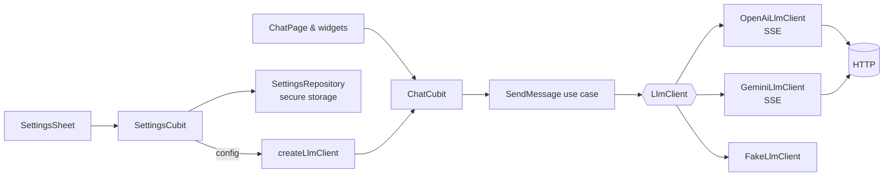

# AI Assistant — Flutter LLM chat with streaming

[](https://github.com/trsimanto/flutter-ai-assistant/actions/workflows/flutter.yml)

A Flutter chat app that streams answers token by token from **OpenAI-compatible** and **Google Gemini** models over Server-Sent Events, built with Clean Architecture and `flutter_bloc`. It runs out of the box in a local demo mode, so you can try it without an API key.

## Features

- **Streaming replies** with a live typing effect (SSE parsing, no SDK lock-in)
- **Two providers behind one interface**: OpenAI Chat Completions (`stream: true`) and Gemini `streamGenerateContent?alt=sse`
- **Demo mode** (`FakeLlmClient`) when no key is set
- **Markdown answers** with code blocks, selectable text
- **Stop generating**, **retry** the last answer, **copy** any answer, **new chat**
- **Prompt presets**: General, Code reviewer, Explain like I'm 5, Translate to Bangla
- **Conversation context** sent with every request (last 20 messages)
- **Secure key storage** from an in-app Settings sheet (Keychain / Android Keystore)
- **Error states** with partial answers kept and one-tap retry
- **Material 3** light and dark themes

## Tech stack

| Area | Choice |
|---|---|
| UI | Flutter, Material 3, `flutter_markdown_plus` |
| State | `flutter_bloc` (Cubit), `equatable` |
| Networking | `http` streamed requests + custom SSE decoder |
| Storage | `flutter_secure_storage` |
| Testing | `flutter_test`, `bloc_test`, `mocktail`, `http/testing` `MockClient` |
| CI | GitHub Actions: analyze + test |

## Architecture



```
lib/
├── core/config/          # LlmConfig (dart-define + runtime override)
├── domain/
│   ├── entities/         # ChatMessage, PromptPreset
│   ├── repositories/     # LlmClient interface, LlmException
│   └── usecases/         # SendMessage (context window + system prompt)
├── data/
│   ├── sse/              # SseDecoder (bytes -> SSE data payloads)
│   ├── clients/          # OpenAI, Gemini, Fake clients + factory
│   └── settings/         # SettingsRepository (secure storage)
└── presentation/
    ├── cubit/            # ChatCubit, SettingsCubit
    ├── pages/            # ChatPage
    └── widgets/          # MessageBubble, Composer, PresetChips, SettingsSheet
```

## Running

```bash
flutter pub get

# Demo mode (no key needed)
flutter run

# OpenAI (or any OpenAI-compatible endpoint)
flutter run --dart-define=LLM_PROVIDER=openai --dart-define=LLM_API_KEY=$OPENAI_API_KEY --dart-define=LLM_MODEL=gpt-4o-mini

# OpenAI-compatible provider with a custom base URL
flutter run --dart-define=LLM_PROVIDER=openai --dart-define=LLM_BASE_URL=https://api.groq.com/openai/v1 \
  --dart-define=LLM_API_KEY=$GROQ_API_KEY --dart-define=LLM_MODEL=llama-3.1-8b-instant

# Gemini
flutter run --dart-define=LLM_PROVIDER=gemini --dart-define=LLM_API_KEY=$GEMINI_API_KEY --dart-define=LLM_MODEL=gemini-2.5-flash
```

You can also paste a key at runtime from **Settings** (top right).

### A note on API keys

Keys are never committed or hard-coded. They come from `--dart-define` or the Settings sheet, which stores them in the platform keystore. For a production app, put the model behind your own backend so the provider key never ships inside the client.

## Testing

```bash
flutter analyze
flutter test
```

- SSE decoder: chunked bytes, CRLF, multi-line data, comments
- OpenAI and Gemini chunk parsing, request building, headers and error handling (with `MockClient`)
- `ChatCubit`: streaming, blank input, errors with partial text, retry, stop, presets, new chat
- Widget test for the send flow

## Roadmap

- Persist conversations locally (Drift / Isar)
- Image input for multimodal models
- On-device model option
- Token usage and cost display

## Author

**Towhidur Rahman** — Lead Mobile Developer · [linkedin.com/in/trsimanto](https://www.linkedin.com/in/trsimanto)
